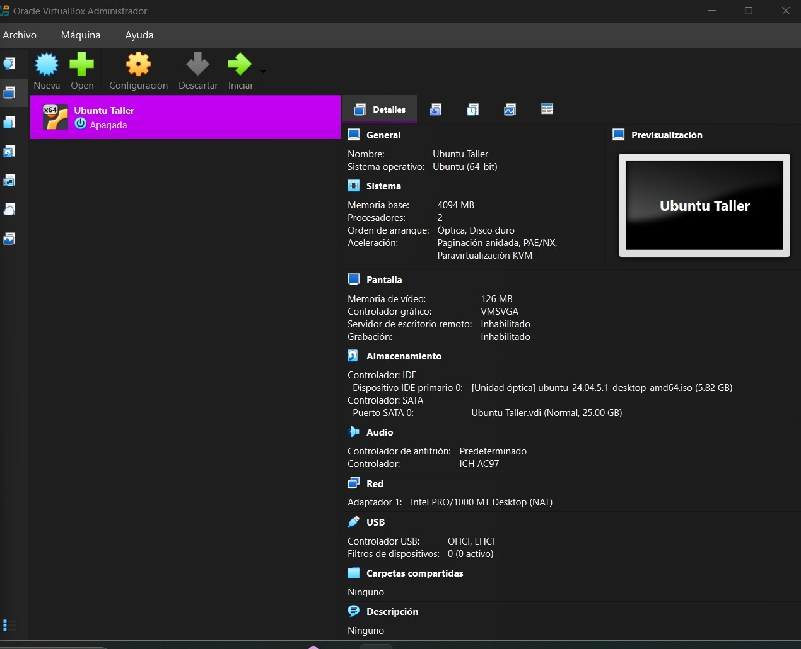
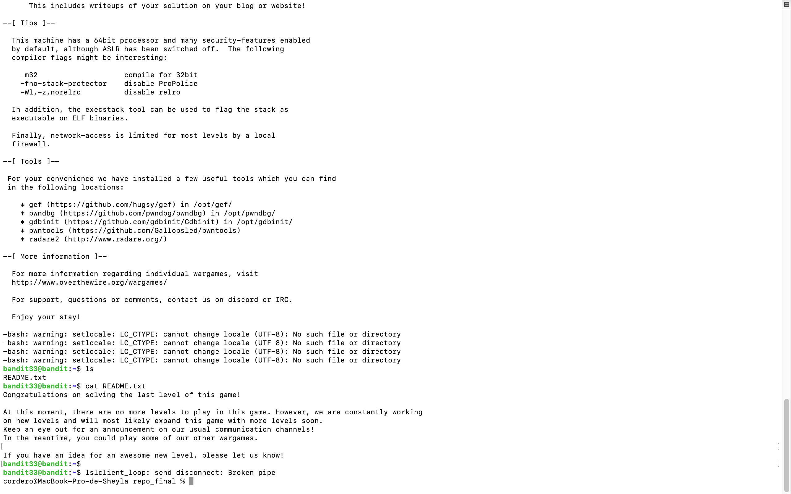
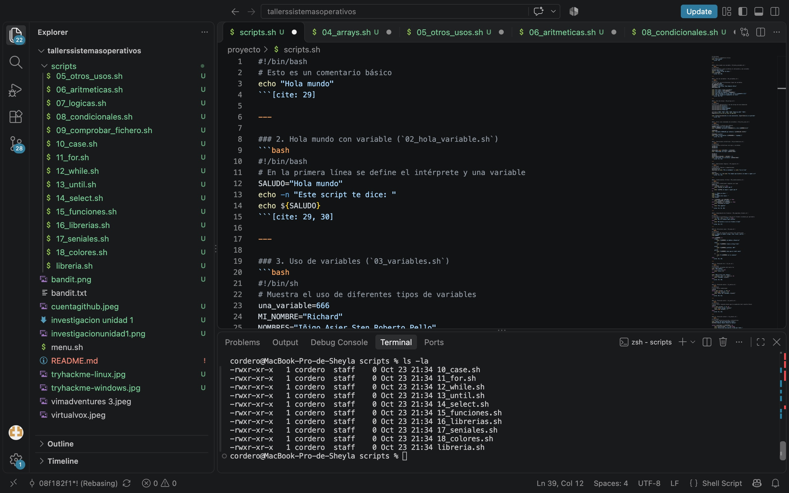
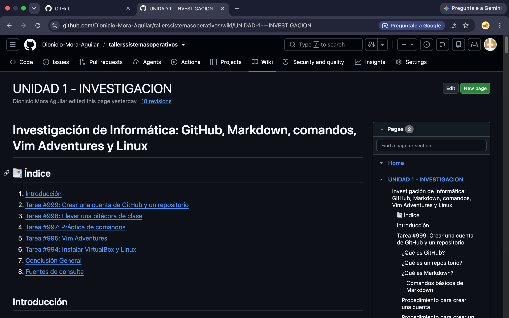
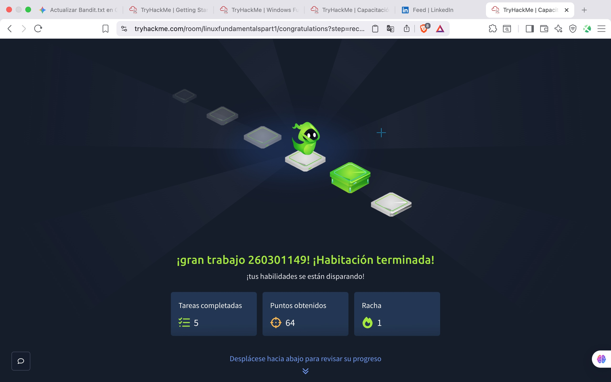
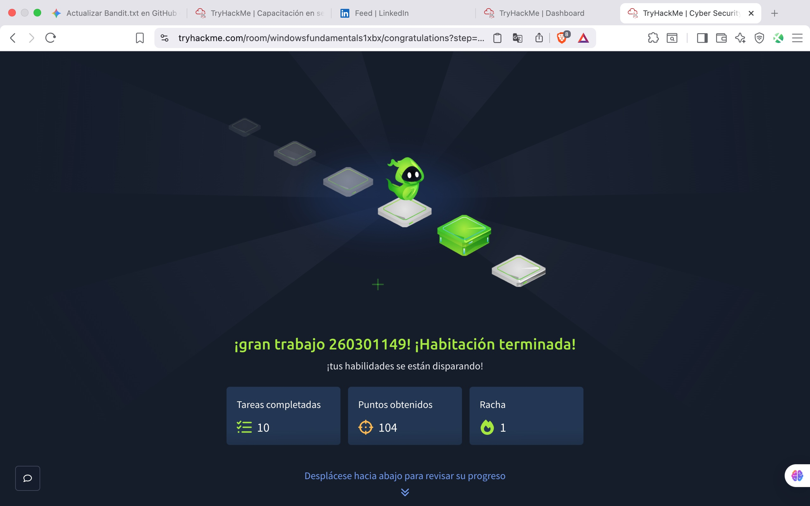

# tallerssistemasoperativos

# 🚀 Repositorio de Tareas y Prácticas parcial 1

**Estudiante:** Dionicio Mora Aguilar
**Fecha Límite:** 21/09/2026  

---

## 📋 Resumen General de Tareas

| ID | Tarea / Actividad | Estado | Fecha Límite | Evidencia / Captura |
| :---: | :--- | :---: | :---: | :---: |
| **#999** | [Cuenta github] (crear cuenta git hub.jpeg) | [] Completado | 21/09/2026 | [cuenta github](cuentagithub.jpeg) |
| **#998** | Llevar una bitácora de clase | [ ] incompleta | 21/09/2026 | [Ver Evidencia](ruta/al/video.mp4) |
| **#997** | Práctica de comandos | [ ] Pendiente | 21/09/2026 |  |
| **#995** | Realizar los niveles gratuitos de Vim Adventures | [ ] Pendiente | 21/09/2026 |  |
| **#994** | Instalar Virtualbox y distribución de Linux | [ ] Pendiente | 21/09/2026 |  |

# 🚀 Repositorio de Tareas y Prácticas - Parcial 2

**Estudiante:** Dionicio Mora Aguilar

---

## 📋 Resumen General de Tareas (Parcial 2)

| ID | Tarea / Actividad | Estado | Fecha Límite | Evidencia / Captura |
| :---: | :--- | :---: | :---: | :---: |
| **#996** | [bandit](bandit.txt) | [ ] completada | 09/10/2026 |  |
| **#993** | [menu bash](menu.sh)| [ ] Completado | 16/10/2026 ||
| **#992** | Realizar los 18 scripts del pdf de shell  | [ ] completado | 16/10/2026 |  |
| **#990** | [investigacion] (investigacion unidad 1)  | [ ] completada | 16/10/2026 |  |
| **#989** | Realizar el módulo Linux Fundamentals de TryHackMe | [ ] completado | 23/10/2026 |  |
| **#988** | Realizar el modulo de windows en tryhackme | [ ] completada | 23/10/2026 |  |
=======
